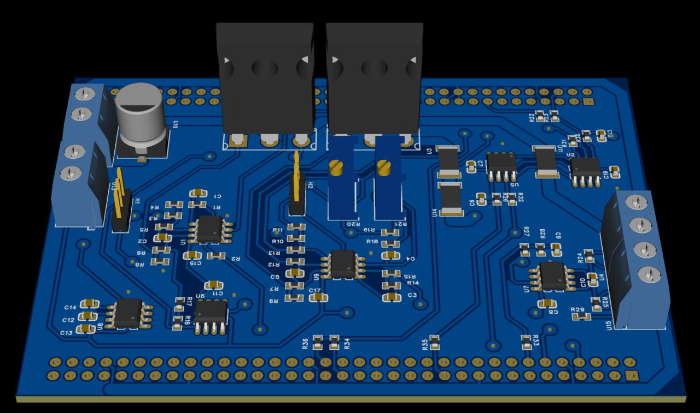
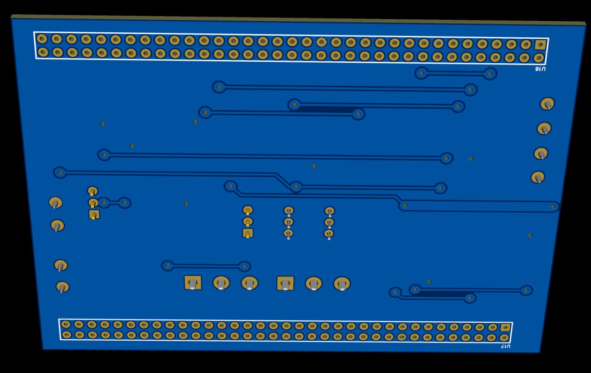
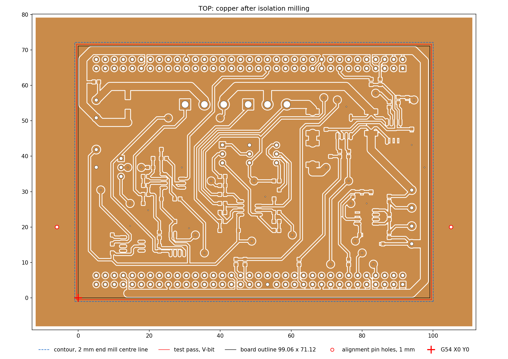
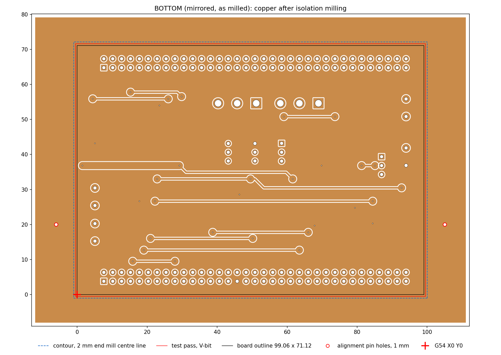

# CNC PCB Engraving — Victor PCB

Double-sided PCB made on a small GRBL router: isolation milling, drilling and outline cut from Gerber files, with a
FreeCAD CAM project built from the Gerber data.

## Project status — 2026-11-23

- **Gerber data** (EasyEDA Pro, 2026-11-22): parsed and checked against the netlist in `FlyingProbeTesting.json`
  — no shorts, no open nets.
- **FreeCAD project:** `Victor_PCB.FCStd`, 5 CAM jobs in 4 tasks, G-code exported with `grbl_post`.
- **G-code:** isolation checked by simulation, hole positions and depths compared with the Gerber data (section 6).
- **Not yet done:** nothing has been milled. Feeds and depths come from the HobbyTouristing reference project or are
  assumptions (section 2).
- **Decided 2026-11-23:** connector holes 1.0 mm, vias 0.3 mm, board cut as it is (no re-routing).
- **Next:** open points of section 7, test cut.

## Files for review

| File | What it is |
|---|---|
| [FreeCAD project](Victor_CNC/Victor_PCB.FCStd) | Board model, copper, isolation lines, 5 CAM jobs (FreeCAD 1.1) |
| [G-code](Victor_CNC/nc/) | One file per job, numbered in machining order |
| [Top after milling](Victor_CNC/out/top_milled.png) · [Bottom after milling](Victor_CNC/out/bottom_milled.png) | Simulated copper, drawn from the cutter paths |
| [Gerber files](Victor_CNC/Gerber_PCB1_2026-11-22/) | Source data |

## Board view

Copper after milling, top:

Bottom, mirrored as it lies on the machine after the flip:

## 1. Input requirements

| # | Requirement |
|---|---|
| R1 | Make the board from the Gerber files on the CNC router |
| R2 | Isolation with the V-bit from the existing tool library |
| R3 | Outline with the 2 mm end mill |
| R4 | Vias drilled 0.3 mm, other holes 1.0 mm; contour with holding tabs like the reference |
| R5 | Use the `HobbyTouristing` project as the reference for tool bits and settings |

Board data from the Gerber files:

| Item | Value |
|---|---|
| Outline | 99.06 × 71.12 mm, rectangle |
| Layers | 2 |
| Minimum gap between copper islands | 0.298 mm; one place 0.105 mm on the bottom (H1-2 pad to the next via, both in net `$1N12`) |
| Holes | 32 vias 0.8 mm · 6 × 0.762 mm (R20, R21) · 154 × 0.8 mm (connectors, headers, terminals) · 6 × 1.7 mm (Q1, Q2) |

## 2. Assumptions (to be confirmed)

| Assumption | Value used |
|---|---|
| Board thickness | 1.6 mm (reference stock was 1.7 mm; through depths cover both) |
| Copper | 35 µm |
| Blank | board + 12 mm in X and + 8 mm in Y on each side = 123.1 × 87.1 mm minimum |
| Spindle | `S1000`, as in the reference project |
| Feeds | V-bit 90 / 20 mm/min (reference 120 / 20, XY lowered by a quarter on 2026-11-23); end mill 100 / 30 from the reference; drills 30 (0.3 mm) and 60 (1.0 mm) mm/min are estimates |
| Isolation depth | 0.05 mm in one pass, as in the reference (decision 2026-11-23, before that 0.10 mm) |
| Flatness | copper is 0.035 mm thick, so at 0.05 mm depth a spot only 0.015 mm below Z0 stays uncut: **a height map is needed** unless the blank is that flat. The V-bit bites into copper tracks below about 0.18 mm depth  |

## 3. Tools

| T | Tool bit | Data | Source |
|---|---|---|---|
| 1 | `v_bit_30gr_0.2mm` | 30°, **tip 0.2 mm**, shank 3 mm, 2 flutes | existing library (Aliexpress_Milling) |
| 2 | `endmill_d2mm_h10mm` | 2 mm, 4 flutes, 10 mm cutting height | existing library (Aliexpress_Milling) |
| 3 | `drill_d0.3mm` | 0.3 mm, 118° | **new**, only in this project: the library has no drills |
| 4 | `drill_d1.0mm` | 1.0 mm, 118° | **new**, as above |

The `.fctb` files are in `Victor_CNC/ToolBits/`.

Cut width of the V-bit = 0.2 + 2 · depth · tan 15°: **0.227 mm at 0.05 mm**, 0.254 mm at 0.10 mm, 0.298 mm (the gap) at 0.18 mm.

## 4. CAM jobs

Coordinates: X0 Y0 = lower left corner of the board, Z0 = copper surface. G54 in all files.

| # | Task | Tool | Depth | Feed XY / Z, mm/min | G-code | Time (FreeCAD estimate) |
|---|---|---|---|---|---|---|
| 1 | Test rectangle + isolation, top | V-bit | −0.05 | 90 / 20 | `01_Top_Isolation_V30.nc` | 68 min |
| 2 | Vias, 32 holes | drill 0.3 | −1.85 | — / 30 | `02_Drill_0.3_Vias.nc` | not estimated |
| 3 | Connectors, terminals, R20 / R21 (160 holes) and 2 alignment holes | drill 1.0 | −2.1 / −6.0 | — / 60 | `03_Drill_1.0_Holes.nc` | not estimated |
| 1 | Test rectangle + isolation, bottom | V-bit | −0.05 | 90 / 20 | `04_Bottom_Isolation_V30.nc` | 32 min |
| 4 | Q1 / Q2 holes, then contour with 8 tabs | end mill 2 mm | −2.0, then −1.85 step 0.3 | 100 / 30 | `05_Contour_2mm.nc` | 25 min |

File numbers give the machining order; the first column is the task.

- **Test pass:** both isolation files start with a closed V-bit rectangle at the working depth, 0.5 mm outside the board
  outline, to check that the laminate is flat. The contour cutter removes it later. Then the tool goes to Z15, the
  spindle stops and the program waits (`M0`).
- **Isolation** is a single line in the middle of the gap around each copper island.
- **Drilling** uses pecks; `G81`/`G83` are translated to `G0`/`G1` because GRBL has no canned cycles.
- **Gerber diameters changed:** vias 0.8 → 0.3 mm, connectors and terminals 0.8 → 1.0 mm, R20 / R21 0.762 → 1.0 mm.
- **Q1 / Q2 holes** are 1.7 mm in the Gerber data. The smallest tool near that size is the 2 mm end mill, so they become
  2.0 mm (pad 2.9 mm, ring 0.45 mm).
- **Tabs:** holding tabs (`DressupTag`) as in HobbyTouristing, 45°, enlarged for this board: 8 tabs, 0.4 mm thick,
  0.7 mm wide at the top and 1.5 mm at the bottom of the board (`Width` 2 mm, `Height` 0.65 mm; the reference has 1 and
  0.3 mm, which would leave about 0.05 mm of a 1.6 mm board).
- `M6` is commented out by the post processor: change the tool by hand and set Z0 again for every file.

## 5. Machining order

At the `M0` pause of files 01 and 04 look at the rectangle: the groove must be continuous and equally wide (0.23 mm) all
round, and the multimeter must show no contact between the copper inside and outside of it. If not, stop the program,
correct the fixing or Z0 (or use a height map) and start the file again. If yes, resume; the spindle restarts by itself.

1. Fix the blank on a sacrificial board at least 5 mm thick, top copper up. Set X0 Y0 and Z0.
2. Run files 01 to 03 and change the tool between files. File 03 also drills the alignment holes at (−6, 20) and
   (105.06, 20), 6 mm deep (about 4.4 mm into the sacrificial board).
3. Put 1.0 mm pins into the two holes and turn the blank **left to right** (around the Y direction). Keep X0 Y0. The pins
   must not stick out above 3 mm.
4. Set Z0 on the bottom copper, then run files 04 and 05.
5. Break the tabs.

Safe heights: isolation moves at 1.5 mm, everything else at 5 mm. Keep clamps outside the blank area used by the paths.

## 6. Verification so far

| Check | Result |
|---|---|
| Gerber copper + drills against the netlist | no shorts, no open nets |
| Top, G-code subtracted from a full copper blank, cut 0.227 mm | 192 islands, 0 shorts, 0 breaks, no bite into copper |
| Bottom, same check | 175 islands, 0 shorts, 0 breaks, 0.16 mm² bite at the 0.105 mm place (same net) |
| Same at 0.254 mm cut (0.10 mm depth) | 0 shorts, 0 breaks on both sides |
| Hole positions and depths, files 02, 03, 05 | 32, 162 and 6 holes; none extra, missing or of wrong depth |
| Test rectangle, files 01 and 04 | one closed line, (−0.5, −0.5) to (99.56, 71.62), one `M0` before the isolation |
| Rapids | no `G0` below Z0 in the isolation files |
| Project reopened in FreeCAD 1.1 | 5 jobs, no invalid objects |

The simulation uses an ideal cutter on flat copper; it does not cover runout, tool wear or a warped blank.

## 7. Open points

1. **Vias at (69.85, 36.83) and (97.56, 36.83)** carry the load current: Q2 → U3 → U14 → GND passes through both.
   **Decision 2026-11-23: they stay 0.3 mm.** Solder the thickest wire that fits, and watch their temperature
   at the first load test.
2. **0.3 mm drill:** needs low runout and high spindle speed; the 32 vias need a wire of 0.25 mm or thinner, soldered on
   both sides.
3. **Component-side soldering** (accepted, board not changed): holes are not plated and the copper of U4, U12, U13, U15,
   H1, H2, Q1, Q2, R20 and R21 is on the top side, under the parts, so their pins must be soldered from the top.
   U16 and U17 sit on the bottom and are soldered from the top without problem.
4. **Terminals:** check that the pins pass a 1.0 mm hole.
5. **Alignment pins** are 1.0 mm (no extra tool change); for stiffer pins use 2 mm holes with the end mill.
6. **Solder bridges:** there is no solder mask and the gap to the ground pour is 0.3 mm.

## 8. Next steps

1. Check the terminal pins (section 7, point 4).
2. Run the test rectangle, check the groove (section 5).
3. Mill the board; correct feeds and depths.

## 9. Repository

| Path | Content |
|---|---|
| `Victor_CNC/Gerber_PCB1_2026-11-22/`, `.zip` | Gerber, drill and test data from EasyEDA Pro |
| `Victor_CNC/Victor_PCB.FCStd` | FreeCAD CAM project |
| `Victor_CNC/nc/` | G-code |
| `Victor_CNC/ToolBits/` | Tool bits (`.fctb`) |
| `Victor_CNC/out/` | Pictures of the milled copper |
| `Victor_CNC/scripts/` | `gerber_parse.py`, `isolation.py` (paths), `build_project.py` (FreeCAD project and G-code), `verify.py` (simulation), `report.py` (pictures) |

Rebuild: run `isolation.py` with the FreeCAD Python, then open `build_project.py` with `FreeCAD.exe` (about 2 minutes;
the script writes the project and the G-code and closes FreeCAD). The output paths of the jobs are absolute.
